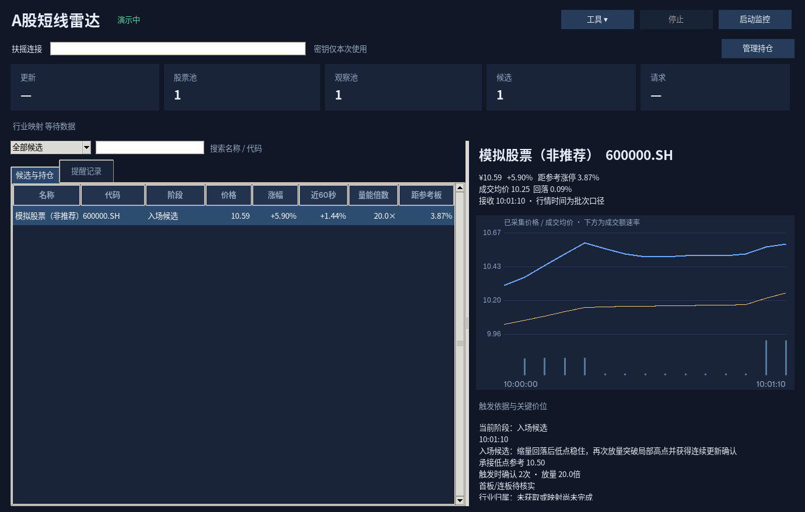

# A股短线雷达

Windows 本地看盘提醒工具：竞价和高开建立候选，盘中确认“拉升 → 缩量回落 → 低点暂稳 → 再次放量突破”。电脑提醒，手机手动下单。仅使用 Python 标准库，无券商登录或下单接口。

## 启动与升级

1. 安装官方 Python 3.11 以上版本，建议 3.12，保留 Tcl/Tk 和 Python Launcher。
2. [从 GitHub 下载](https://github.com/xilu012/Short-term-strategy/archive/refs/heads/main.zip)，解压到可写文件夹。
3. 双击 `start_windows.cmd`。首次在右上角“工具 → 合成行情演示”检查图表、弹窗和声音。
4. 在“扶摇连接”输入 API Key，再点击“启动监控”。密钥只保留在本次内存，也支持安全注入 `FUYAO_API_KEY` 环境变量。
5. 电脑保持联网且不休眠。午休自动等待、下午自动恢复；午休后的结构重新积累。关闭窗口即停止。

升级时先停止并关闭旧程序，备份旧目录的 `data` 文件夹。将其中的数据复制到新版本目录的 `data`，即可保留原始行情和手工持仓；不用上传或分享这些文件。新版本保留原有 SQLite 表和持仓基础字段。运行记录增加版本及参数信息，旧记录仍保留。

自定义参数覆盖文件若含旧的 `max_gain_pct` 字段，需要删除该字段：新版本取消9.5%硬上限，改为是否达到参考涨停价及盘中结构判断。不要直接用旧 `config.json` 覆盖新文件，以免缺少新增参数。

若双击失败，在项目文件夹终端执行 `py -3 -X utf8 monitor.py`；没有 `py` 时使用 `python -X utf8 monitor.py`。缺少 tkinter 时通过官方 Python 安装器添加 Tcl/Tk。程序不自动购买数据套餐；使用前核实账户权益、收费及限额。

## 界面



- 标题为“A股短线雷达”。顶部明确显示监控、休市、重连、行情过旧或停止状态，展示最近接收时间、股票池、观察池、候选数和请求耗时。
- 候选表按阶段更新同一股票行，支持搜索与筛选；不再将全部信号堆成正文。
- 右侧显示已采集分时价格、成交均价、成交额速率、回落幅度、距参考涨停空间、触发依据及确认次数。
- “提醒记录”保留本次会话记录；演示与实盘会话切换时清空界面，数据库分别保存。
- “管理持仓”记录真实持仓；不会因为出现候选就假定你已经买入。
- “工具 → 市场与行业背景”可关闭附加接口，本次运行生效。长期关闭可在 `config.json` 将 `context_enabled` 设为 `false`。
- “工具 → 数据连接状态”可查看具体哪个附加接口缺少权限或字段，不显示密钥。

图表仅显示本次会话已采集的最近360个变化点，不补画启动前或关机期间走势。下方柱线是相邻观察之间的成交额速率，不是交易所标准分钟成交量柱。近60秒涨幅使用窗口内已采集到的价格，采样不足时实际跨度可能短于60秒。参考涨停价及批次时间都有下文所述限制。

## 买入候选规则

高开只提供观察入口，非高开个股盘中转强也可进入。股票池限定沪深主板，排除名称含ST/退、上市不满60自然日、上市日期未知的股票。此筛选不替代逐股交易状态核实。

先滚动扫描全池，再按当日强度选择最多50只重点观察；实际持仓优先。默认每2秒调度一批100只全池股票，重点池约每5秒调度一次。均是调度目标，不是行情更新或提醒时延承诺。请求耗时、附加请求和退避会改变实际间隔，全池快速异动仍可能漏报。

实验买入流程：

1. 过去180秒已采集样本上涨至少1.5%，至少4个样本，当日涨幅至少3%。
2. 从本轮高点回落0.6%–2.5%，保留前一段上涨幅度至少50%，成交速率降至拉升期的0.8倍以下。
3. 低点暂稳至少15秒，且有至少3次有效更新；用于确认的采样间隔不超过12秒。缓存不动的行情不能确认企稳。
4. 相对低点反弹至少0.5%，突破回落后的局部高点0.1%以上，成交速率至少达到回落期的1.5倍。
5. 再上攻至少2次连续确认、覆盖至少5秒，确认期间增量成交额至少10万元。单次脉冲不会直接成为入场候选；连续确认失败达到2次则结束本轮观察。

这些参数是明确的研究起点，未经独立样本优化，不代表最佳数值。连续确认会引入等待，也可能错过快速封板，需与单次信号的误报率和可成交性一起验证。

取消旧版9.5%涨幅上限：接近涨停的机会继续按结构判断。已经达到参考涨停价时不再生成新入场候选，也不假设可以成交。参考价只按普通主板前收乘1.1、按分四舍五入，不是交易所逐股权威涨停价，无法识别封单或是否真正封板。

候选30秒有效；跌破承接低点、达到参考涨停、超时或价格向上偏离触发位置0.8%时失效，同股冷却300秒。超过90秒采样中断、累计量重置时重新识别结构。暂停、重连、停止时界面不会把旧候选继续作为正在确认的信号。买入当日T+1限制意味着失效线不能当作当天可执行的止损。

## 次日持仓规则

录入完整代码、实际成本、股数和买入日期。卖出后及时移除记录；跨日加仓不支持分批可卖数量计算，须自行核实。

- 买入当日：只标记T+1，不生成退出提醒。
- 次日起：亏损达到5%即提示“持仓风险”，不再统一等待09:35。
- 参考涨停附近：继续观察，无法据此判断真实封板质量。
- 09:35后：程序观察到的当日高点盈利至少1%，随后从该高点回落2.5%，提示利润回吐；或跌破近期连续采样支撑并低于成交均价，提示承接转弱。
- 默认10:30起：仍低于开盘价与成交均价，提示“持仓复核”，并非强制按此时价格卖出。
- 风险、转弱和到时复核分别冷却，较早的普通提醒不会屏蔽随后风险提醒。

风险与利润回吐参数可在 `config.json` 调整。无法保证按阈值价格成交，也不能保证亏损不超过5%或10%。持仓当日高点只使用实际观察到的价格，并保存在本地，不能补齐关机时的高点。支撑与均价只是可解释的实验退出依据。

## 市场与行业背景

附加数据不作为买入硬过滤，也不输出未经验证的“涨停概率”。默认每120秒尝试更新市场信息；各附加请求至少间隔5秒，重点池请求优先。行业成分逐批加载，当日结果缓存，不在每次提醒时重新拉取全量映射。

- 交易日历：可用时辅助识别非交易日；无权限时仍按北京时间周末/时段及行情新鲜度过滤。
- 上一交易日涨停池：从日历确定日期，完整分页并核对数量后，标记“昨日非涨停·首板候选”或“昨日N连板·晋级观察”。这是信号发生前的分类，不代表今天最终会涨停。缺失时显示“待核实”。
- 市场统计：显示全市场涨停家数、打开家数、封板率，核对业务日期和采样时间。市场统计口径包含其他板块，与本程序主板股票池不同。
- 行业背景：用文档支持的行业目录与成分股接口建立归属，再显示行业指数涨幅及个股相对行业的涨幅差。归属未完成显示“未获取”，不猜测、不用文本关键词冒充板块映射。
- 上游未授权/字段缺失的附加任务本次停止重复请求，个股行情继续；网络失败或限流仍共用退避，不密集重试。超过有效期的信息不作为当前数值显示。

当前未统计个股当日冲板失败次数、板块内部同步上涨家数、封单及逐笔成交。不要把“行业指数上涨”视为已经完成板块共振验证。

## 采集、回放与验证

`data/market.sqlite3` 保存真实行情、附加数据、信号及运行版本/参数；`data/demo.sqlite3` 只保存合成演示。信号记录触发当时的均价、放量倍数、确认次数、涨停空间及当时可用的市场背景。`data/positions.json` 保存手工持仓，`data/industry-members-日期.json` 保存行业成分缓存。整个 `data` 被Git忽略，不上传密钥和个人持仓。

```powershell
# 无密钥演示
py -3 -X utf8 monitor.py --demo
# 单次真实行情验证：安全提示输入密钥，不回显
py -3 -X utf8 monitor.py --probe
# 小范围采样（仍读取代码表）
py -3 -X utf8 monitor.py --live --codes 600000.SH,000001.SZ --max-cycles 10
# 回放原始采样，只输出信号，不模拟成交
py -3 -X utf8 monitor.py --replay data/market.sqlite3
# 离线回归，桌面测试在Windows或有DISPLAY时执行
py -3 -m unittest -v
```

回放使用当前参数；可加 `--config custom.json` 覆盖，比较不同规则。历史参数另存于sessions，旧版记录是平铺参数，新版为version/parameters对象。回放不包含历史持仓退出仿真或市场背景硬过滤，不会通过未来涨停结果筛选样本。数据文件可能持续增长，请停止程序后备份和归档。

信号回放不是收益回测：没有模拟佣金、印花税、滑点、反应延迟或未成交，不报告胜率。评估需保留全部失败信号，区分首板/连板和交易日，采用可执行的成交及退出规则，在独立时段比较扣费后的胜率、平均盈亏和回撤。

## 数据限制与运行安全

来源：[扶摇完整文档](https://fuyao.aicubes.cn/llms-full.txt)。Base URL 固定为 `https://fuyao.aicubes.cn`，使用 `X-api-key` 请求头，保留TLS验证，禁止密钥随重定向发送至其他地址。

- 价格历史接口当前仅支持日线。资金流向/高频指标的分钟数据不是分钟价格，不用于伪造历史盘中回测。
- 行情快照timestamp是该批次最新有效上游时间，不是逐股时间。排除未知、过旧或明显未来时间后，仍不能保证批内每只股票新鲜。
- 竞价快照timestamp为响应组装时间，不用它计算真实行情时延。
- HTTP成功仍检查业务code；2001停止，主行情2003停止；附加2003降级。429/4001指数退避，最多120秒。
- 文档未承诺确定QPS、更新时间、实测延迟或具体收费；不限制累计次数不等于无限请求或免费。
- 09:25–09:30获取竞价终态，09:30–11:30及13:00–15:00连续监控。跨日需重新启动刷新股票状态。

## 版本与回溯

[GitHub提交记录](https://github.com/xilu012/Short-term-strategy/commits/main/)保留每次改动。初始基准为 `7330baa`，可[下载初始版本](https://github.com/xilu012/Short-term-strategy/archive/7330baac94a4acba7faa51f293f131a3b19177bb.zip)。参见 [CHANGELOG.md](CHANGELOG.md)。代码版本不能替代个人行情与持仓备份。

新版已做离线规则、采集回放、附加权限降级和虚拟桌面交互测试；仍需在真实Windows、当前账号权限和交易时段检验新版的速度与信号质量，没有收益或高胜率结论。
